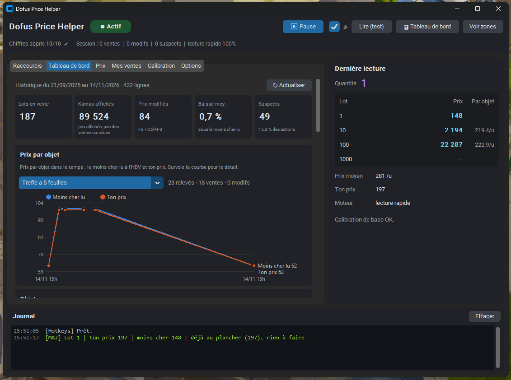

# Dofus Price Helper

Assistant de vente pour l'Hôtel de Vente de Dofus. L'outil lit l'écran par OCR, calcule un prix juste sous le moins cher, le saisit dans « Prix du lot », le vérifie, puis valide.


> [!WARNING]
> Les conditions d'utilisation d'Ankama interdisent en général les logiciels tiers qui interagissent avec le client de jeu. La mise en vente automatique et la mise à jour de toute la liste (Ctrl+F3) sont désactivées par défaut. Leur utilisation se fait à vos risques.

## Sommaire

- [Démonstration](#démonstration)
- [Fonctionnalités](#fonctionnalités)
- [Installation](#installation)
- [Utilisation](#utilisation)
- [Sécurité des prix](#sécurité-des-prix)
- [Configuration](#configuration)
- [Structure du projet](#structure-du-projet)
- [Tests](#tests)
- [Licence](#licence)

## Démonstration


| Interface | Zones calibrées dans l'HDV |
|---|---|
|  |  |
| **Tableau de bord** | **Onglet Calibration** |
|  |  |

## Fonctionnalités

**Vente**
- **F1** : vend l'objet sélectionné dans l'inventaire, ou met à jour le prix d'une de vos ventes. Le mode est détecté automatiquement.
- **F2** : remet en vente au même prix tant que la situation le permet et passe au lot inférieur quand le stock baisse.
- **Ctrl+F3** : met à jour toute la liste de vos ventes, avec défilement automatique.

**Fiabilité**
- Relecture du champ « Prix du lot » avant chaque validation.
- Prix plancher calculé à partir du prix moyen, pour ne pas suivre un vendeur qui brade.
- Blocage des lectures douteuses (confiance faible, incohérence entre lots).

**Performance**
- Reconnaissance des chiffres du jeu apprise automatiquement, environ 5 ms par lecture, avec Tesseract en secours.
- Attente des changements à l'écran plutôt que des pauses fixes.

**Ergonomie**
- Assistant de calibration pas à pas, avec vérification finale.
- Zones qui suivent la fenêtre de l'HDV lorsqu'elle est déplacée.
- Bandeau de résultat au-dessus de l'HDV et fenêtre toujours au premier plan.
- Tableau de bord intégré : activité, historique et évolution du prix par objet.

## Installation

### Prérequis

- Windows 10 ou 11
- Python 3.10 ou plus récent
- [Tesseract OCR](https://github.com/UB-Mannheim/tesseract/wiki), avec la langue française (recommandée pour la lecture du nom des objets)
- Dofus en mode fenêtré ou plein écran fenêtré

### Étapes

```bash
git clone https://github.com/Jul1111/Auto-Dofus-Price-Update
cd Auto-Dofus-Price-Update
python -m venv venv
venv\Scripts\activate
pip install -r requirements.txt
```

Si Tesseract n'est pas installé dans `C:\Program Files\Tesseract-OCR\`, indiquez son chemin dans `TESSERACT_CMD` (fichier de configuration).

### Lancement

```bash
python dofus_price_helper_psg.py   # interface graphique (recommandé)
python dofus_price_helperV2.py     # ligne de commande
```

Le module `keyboard` peut nécessiter des droits administrateur.

## Utilisation

### Première calibration

Au premier lancement, l'assistant de calibration s'ouvre automatiquement (sinon : onglet **Calibration**, puis **Ouvrir l'assistant de calibration**). Il décrit chaque zone à sélectionner dans le jeu et termine par un test de lecture complet.

| Zone | Statut |
|---|---|
| Tableau « Actuellement en vente » | Obligatoire |
| Menu « Quantité » | Obligatoire |
| Champ « Prix du lot » | Obligatoire |
| Titre « Hôtel de vente » | Recommandé (suivi de la fenêtre) |
| Prix moyen | Recommandé (prix plancher) |
| Bouton « Modifier » | Recommandé (F1 automatique, F3) |
| Compteur de lots, lignes de la liste | Optionnel (F2 vérifié, Ctrl+F3) |

### Raccourcis

| Touche | Action |
|---|---|
| `F1` | Vendre (objet de l'inventaire) ou mettre à jour (une de vos ventes) |
| `F2` | Tout vendre au même prix |
| `F3` | Mettre à jour la vente sélectionnée |
| `Ctrl+F3` | Mettre à jour toute la liste (à activer dans l'onglet **Mes ventes**) |
| `F4` | Meilleur lot (prix par objet le plus élevé) |
| Même touche deux fois | Forcer une lecture jugée suspecte |
| `Ctrl+Alt+P` | Pause et reprise, arrêt des boucles |
| `Ctrl+Alt+V` | Afficher les zones calibrées |

Les raccourcis de calibration (`Ctrl+Alt+F1` à `Ctrl+Alt+F11`) sont listés dans l'onglet **Calibration**.

## Sécurité des prix

| Situation | Comportement |
|---|---|
| Lecture incertaine ou prix incohérent entre lots | Prix copié uniquement ; nouvel appui pour forcer |
| Champ « Prix du lot » différent du prix calculé | Aucune validation |
| Concurrent sous le prix plancher | Vente au plancher, conservation du prix actuel ou arrêt (onglet **Prix**) |
| Votre prix est déjà le plus bas | Aucune baisse |
| F2 : compteur de lots inchangé après une vente | Arrêt |

## Configuration

Les réglages sont modifiables dans l'interface et enregistrés dans `dofus_price_helper_config.json`, créé au premier lancement. Le fichier `dofus_price_helper_config.example.json` liste toutes les options disponibles.

| Option | Description | Défaut |
|---|---|---|
| `UNDERCUT_MODE` / `UNDERCUT_VALUE` | Baisse appliquée (kamas ou pourcentage) | `fixed` / `1` |
| `FLOOR_RATIO` | Prix plancher, en fraction du prix moyen | `0.7` |
| `FLOOR_MODE` | Comportement sous le plancher (`floor`, `keep`, `stop`) | `floor` |
| `VERIFY_BEFORE_ENTER` | Relecture du champ avant validation | `true` |
| `AUTO_VALIDATE` | Mise en vente automatique après saisie | `false` |
| `RELIST_AUTO` | Autoriser Ctrl+F3 | `false` |
| `HOTKEYS` | Raccourcis clavier | voir l'exemple |

## Structure du projet

```
Auto-Dofus-Price-Update/
├── dofus_price_helper_psg.py   Interface graphique
├── dofus_price_helperV2.py     Version ligne de commande
├── dofus_core.py               Moteur : lecture, calcul des prix, saisie, contrôles
├── dofus_digits.py             Reconnaissance rapide des chiffres
├── dofus_items.py              Lecture du nom des objets
├── dofus_dashboard.py          Calculs du tableau de bord
├── docs/                       Captures d'écran
└── tests/                      Tests unitaires et tests OCR sur captures réelles
```

Fichiers générés localement et non versionnés : `dofus_price_helper_config.json`, `dofus_price_history.csv`, `digit_templates.npz`, `hdv_anchor.png`.

## Tests

```bash
pip install -r requirements-dev.txt
pytest
```

## Licence

Distribué sous licence MIT. Voir [LICENSE](LICENSE).

Projet indépendant, non affilié à Ankama.
