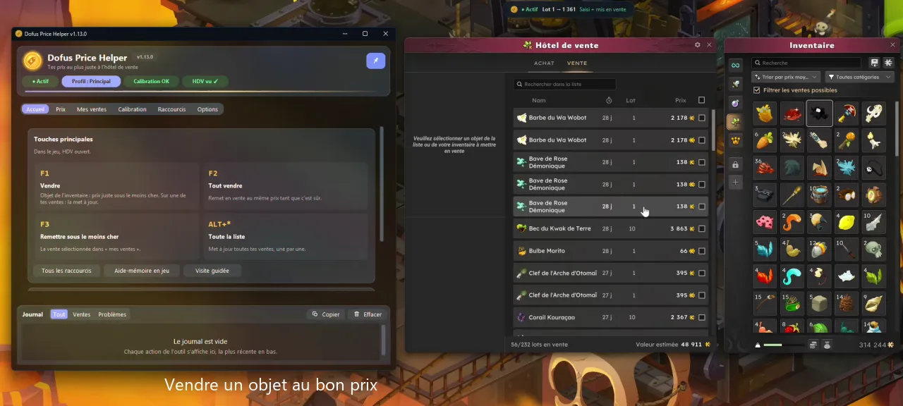
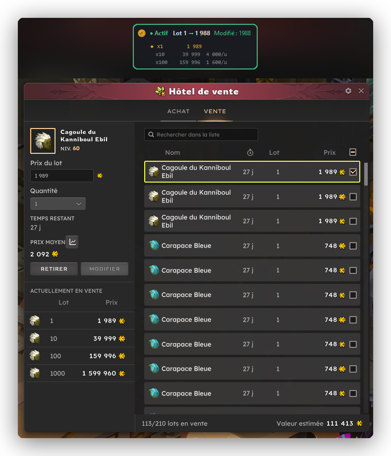

<h1 align="center">Dofus Price Helper</h1>

  Assistant de vente pour l'Hôtel de Vente de Dofus : il lit les prix à l'écran, calcule le bon prix et le saisit pour vous.

  
  
  
  

  <a href="https://github.com/Jul1111/Auto-Dofus-Price-Update/releases/latest"><b>Télécharger</b></a> ·
  <a href="docs/GUIDE.md"><b>Guide d'utilisation</b></a> ·
  <a href="docs/INTERFACE.md"><b>L'interface en images</b></a> ·
  <a href="https://github.com/Jul1111/Auto-Dofus-Price-Update/discussions"><b>Discussions</b></a>

> [!NOTE]
> Le projet est encore en développement actif. Les fonctionnalités, l'interface, les raccourcis et le format des réglages peuvent évoluer fréquemment d'une version à l'autre. Consultez les [notes de version](https://github.com/Jul1111/Auto-Dofus-Price-Update/releases) avant chaque mise à jour ; vos réglages et votre calibration sont conservés lors des mises à jour.
>
> **Vos retours sont les bienvenus.** Le projet étant en cours de développement, chaque retour aide à l'améliorer : un bug, une lecture de prix incorrecte, une idée ou une suggestion sur l'interface. Partagez-les dans les [Discussions](https://github.com/Jul1111/Auto-Dofus-Price-Update/discussions) ou en ouvrant une [issue](https://github.com/Jul1111/Auto-Dofus-Price-Update/issues).

> [!WARNING]
> Les conditions d'utilisation d'Ankama interdisent en général les logiciels tiers qui interagissent avec le client de jeu. La mise en vente automatique et la mise à jour de toute la liste sont désactivées par défaut. Leur utilisation se fait à vos risques.

## Démonstration

  

  

<table>
  <tr>
    <td width="50%" valign="top">
       
      <b>Par-dessus le jeu.</b> Le HUD affiche le résultat de chaque action et les prix de l'objet sélectionné. Les clics le traversent.
    </td>
    <td width="50%" valign="top">
       
      <b>Toute la liste en un appui.</b> À la fin, un résumé : prix modifiés, lignes à revoir, durée.
    </td>
  </tr>
</table>

<a href="docs/INTERFACE.md"><b>Visite de l'interface en images →</b></a>

## Points forts

- **Une touche par vente** : `F1` vend ou met à jour le prix, `F2` revend tout le stock, `Ctrl+F3` met à jour toute votre liste.
- **Prix sûrs** : le champ « Prix du lot » est relu avant chaque validation, un prix plancher protège des vendeurs qui bradent, et les lectures douteuses sont bloquées.
- **Vos ventes reconnues** : l'outil ne passe jamais sous votre propre prix, même d'une session à l'autre.
- **Calibration en un clic** : l'HDV est détecté à n'importe quelle résolution et échelle d'interface.
- **Rapide** : environ 5 ms par lecture grâce à un modèle des chiffres du jeu, appris sur votre écran.
- **Discret** : un HUD par-dessus le jeu montre le résultat de chaque action (les clics le traversent), et les profils suivent le personnage en multi-compte.
- **À vos couleurs** : thème sombre ou clair, quatre ambiances, et les 11 thèmes de Dofus pour que l'outil se fonde dans le jeu.

## Installation

Téléchargez la dernière version dans les [Releases](https://github.com/Jul1111/Auto-Dofus-Price-Update/releases/latest) :

- **`DofusPriceHelper-Setup-vX.Y.Z.exe`** (recommandé) : installeur, sans droits administrateur, désinstallable depuis **Paramètres › Applications**.
- **`DofusPriceHelper-vX.Y.Z.zip`** : version sans installation. Décompressez le zip et lancez `DofusPriceHelper.exe`, en gardant le dossier `_internal` à côté.

Rien d'autre à installer : Tesseract est inclus. L'outil se met ensuite à jour en un clic, sans perdre vos réglages.

> [!NOTE]
> L'exécutable n'est pas signé et lit le clavier. Windows SmartScreen peut afficher « Windows a protégé votre PC » : cliquez sur « Informations complémentaires », puis « Exécuter quand même ». Certains antivirus peuvent aussi le signaler.

## Démarrage rapide

1. Dans Dofus (fenêtré ou plein écran fenêtré), ouvrez l'HDV sur l'onglet **Vente** et sélectionnez un objet.
2. Lancez l'outil et acceptez la **calibration automatique** proposée au premier lancement.
3. Appuyez sur `F1` sur un objet de l'inventaire pour le vendre, ou sur une de vos ventes pour ajuster son prix.

| Touche | Action |
|---|---|
| `F1` | Vendre ou mettre à jour le prix de l'objet sélectionné |
| `F2` | Tout vendre au même prix |
| `Ctrl+F3` | Mettre à jour toute la liste (à activer dans **Mes ventes**) |
| `Ctrl+Alt+P` | Arrêter le parcours en cours |

La calibration automatique fonctionne avec Dofus 3 en français. Pour les autres cas, la calibration manuelle, les autres raccourcis et tous les réglages sont décrits dans le [guide d'utilisation](docs/GUIDE.md).

## Aide et contribution

- **Un problème ?** Onglet **Options** › **📦 Rapport de problème**, puis ouvrez une discussion dans [Bugs](https://github.com/Jul1111/Auto-Dofus-Price-Update/discussions/categories/bugs) en joignant le zip.
- **Une question ou une idée ?** Rendez-vous dans les [Discussions](https://github.com/Jul1111/Auto-Dofus-Price-Update/discussions).
- **Envie de contribuer ?** Installation depuis le code source, tests et règles du projet : voir [CONTRIBUTING.md](CONTRIBUTING.md).

## Licence

Distribué sous licence [MIT](LICENSE). Projet indépendant, non affilié à Ankama.
