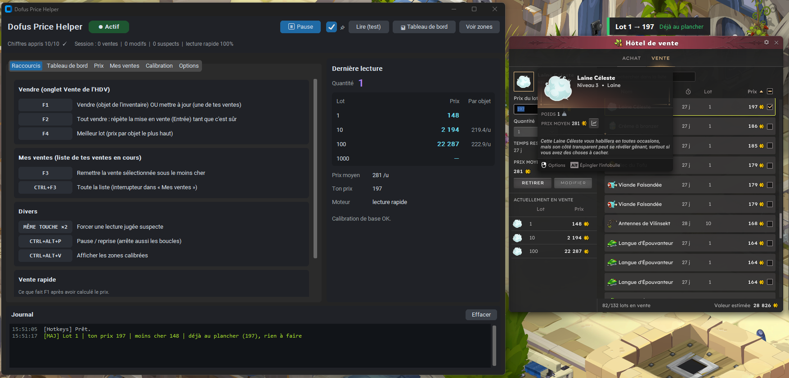
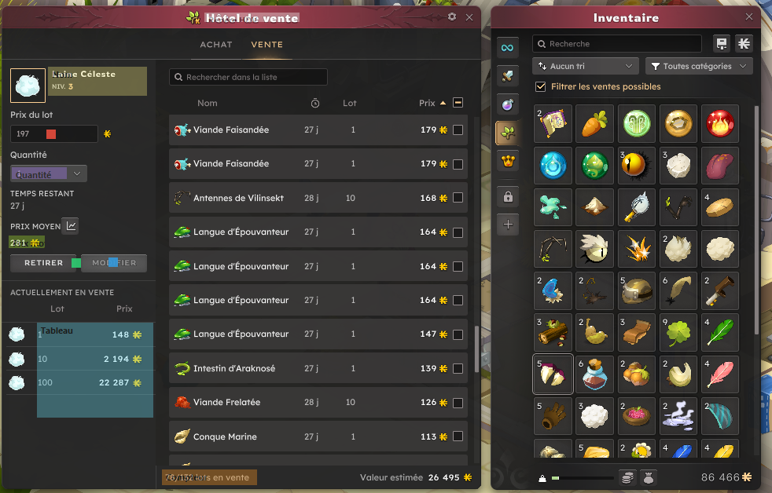
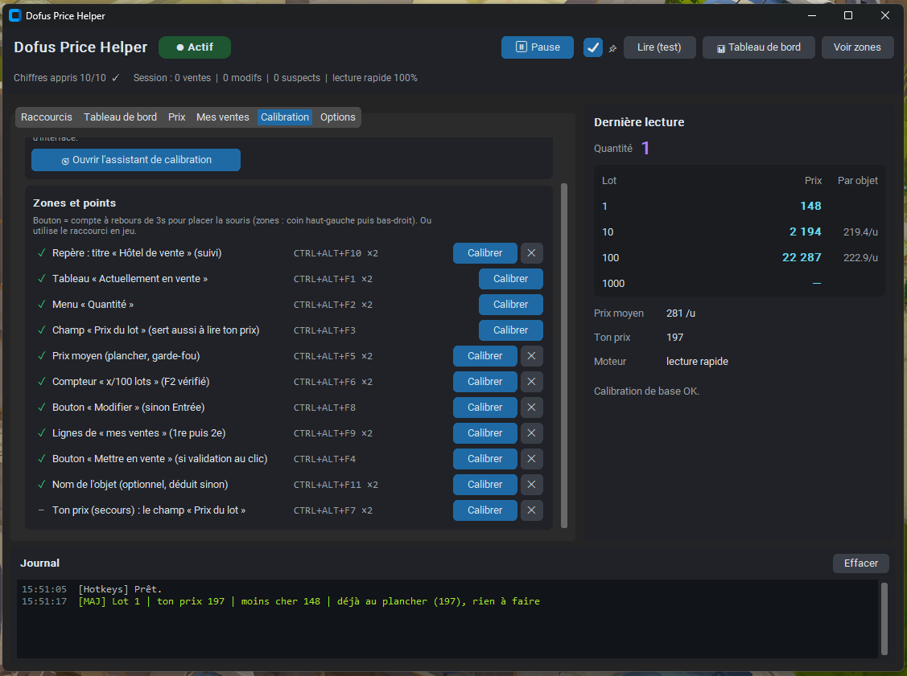

# Dofus Price Helper

Assistant de vente pour l'Hôtel de Vente de Dofus. L'outil lit l'écran par OCR, calcule un prix juste sous le moins cher, le saisit dans « Prix du lot », le vérifie, puis valide.


> [!WARNING]
> Les conditions d'utilisation d'Ankama interdisent en général les logiciels tiers qui interagissent avec le client de jeu. La mise en vente automatique et la mise à jour de toute la liste (Ctrl+F3) sont désactivées par défaut. Leur utilisation se fait à vos risques.

## Sommaire

- [Démonstration](#démonstration)
- [Fonctionnalités](#fonctionnalités)
- [Installation](#installation)
- [Utilisation](#utilisation)
- [Sécurité des prix](#sécurité-des-prix)
- [Configuration](#configuration)
- [Structure du projet](#structure-du-projet)
- [Tests](#tests)
- [Publier une version](#publier-une-version)
- [Participer](#participer)
- [Licence](#licence)

## Démonstration


| Interface | Zones calibrées dans l'HDV |
|---|---|
|  |  |
| **Onglet Calibration** | |
|  | |

## Fonctionnalités

**Vente**
- **F1** : vend l'objet sélectionné dans l'inventaire, ou met à jour le prix d'une de vos ventes. Le mode est détecté automatiquement.
- **F2** : remet en vente au même prix tant que la situation le permet et passe au lot inférieur quand le stock baisse.
- **Ctrl+F3** : met à jour toute la liste de vos ventes, avec défilement automatique.

**Fiabilité**
- Relecture du champ « Prix du lot » avant chaque validation.
- Prix plancher calculé à partir du prix moyen, pour ne pas suivre un vendeur qui brade.
- Blocage des lectures douteuses (confiance faible, incohérence entre lots).
- Reconnaissance de vos propres ventes (par l'image du nom de l'objet) : l'outil ne passe jamais sous votre propre prix, même d'une session à l'autre.

**Performance**
- Reconnaissance des chiffres du jeu apprise automatiquement, environ 5 ms par lecture, avec Tesseract en secours.
- Attente des changements à l'écran plutôt que des pauses fixes.

**Ergonomie**
- **Calibration automatique** : HDV ouvert, un clic (ou `Ctrl+Alt+F12`) et toutes les zones sont placées, quelles que soient la résolution et l'échelle de l'interface. Fonctionne avec **Dofus 3 en français**, sur la même version du jeu que le modèle de l'outil ; sinon, la calibration manuelle reste disponible. Si tu changes ensuite l'échelle de l'interface ou la résolution, l'outil s'en rend compte et refait la calibration automatique tout seul (option dans l'onglet **Calibration**).
- Assistant de calibration pas à pas, avec vérification finale.
- Zones qui suivent la fenêtre de l'HDV lorsqu'elle est déplacée.
- Bandeau de résultat au-dessus de l'HDV et fenêtre toujours au premier plan.
- Raccourcis modifiables dans l'onglet **Raccourcis** (bouton « Changer », puis la touche voulue).
- Ctrl+F3 affiche chaque ligne traitée dans le journal, pendant le parcours, puis un résumé : prix modifiés (ancien → nouveau, avec l'image du nom de l'objet) et lignes à revoir. Les 10 derniers résumés restent consultables dans l'onglet **Mes ventes**.
- Barre d'état en haut : pastilles pour la pause, le profil, la calibration (OK ou à faire) et l'HDV (vu ou introuvable). Un clic sur une pastille mène à l'endroit utile.
- Journal filtrable (**Tout** / **Ventes** / **Problèmes**), bouton **Copier**, et chaque Ctrl+F3 regroupé dans un bloc qu'un clic déplie ou replie.
- Aperçu en direct dans l'onglet **Prix** : « Moins cher 1 000 → ton prix 999 (plancher 700) », recalculé à chaque réglage.
- **Mode compact** (bouton 🗗 Compact) : petite fenêtre toujours au premier plan pendant le jeu, avec la dernière action, l'état et la pause.
- Onglet **Accueil** au démarrage : premiers pas qui se cochent tout seuls (calibrer, tester une lecture, première vente), les touches principales et le bilan de la session.
- Panneau **Activité** : les dernières actions (ancien → nouveau prix, statut en couleur) et la dernière lecture.
- Progression de **Tout vendre** et **Toute la liste** en haut et en mode compact (« Ligne 34 / 87 · 12 modifiées », total connu si le compteur « x/100 lots » est calibré), avec un bouton **Arrêter** qui ne met pas l'outil en pause.
- Aide-mémoire des touches par-dessus le jeu (`Ctrl+Alt+H`) et notification Windows à la fin d'un long parcours quand vous êtes dans une autre fenêtre (désactivable dans **Options**).
- Popups, bandeau et boîtes de confirmation au même style que l'interface.
- Aide au survol sur les options, taille du texte réglable (onglet **Options**), taille et position de la fenêtre mémorisées.
- Style **Verre** (onglet **Options** › Apparence) : le jeu derrière l'outil apparaît flouté, comme une vitre teintée, même pendant que vous jouez ; teinte réglable. Windows 10 (1803+) ou 11. Le style **Classique** reste opaque.
- Profils de calibration (onglet **Calibration**) : un par HDV ou par personnage, on passe de l'un à l'autre en un clic. « Nouveau » copie le profil actuel ; il ne reste qu'à recalibrer ce qui change.

## Installation

### Version Windows prête à l'emploi (recommandé)

1. Téléchargez `DofusPriceHelper-vX.Y.Z.zip` dans les [Releases](https://github.com/Jul1111/Auto-Dofus-Price-Update/releases/latest).
2. Décompressez-le où vous voulez, puis lancez `DofusPriceHelper.exe` (gardez le dossier `_internal` à côté).

Rien d'autre à installer : Tesseract est inclus. Si un Tesseract 5 ou plus récent est déjà installé, c'est lui qui est utilisé. Les réglages et la calibration sont enregistrés dans `%APPDATA%\Dofus Price Helper` et sont conservés d'une version à l'autre.

Au démarrage, l'outil vérifie sur GitHub si une version plus récente est publiée et affiche alors un bouton « ⬆ Installer vX.Y.Z » (désactivable dans l'onglet **Options**) : un clic la télécharge, vérifie le fichier, puis l'outil se ferme et redémarre dans la nouvelle version. Réglages, calibration et profils sont gardés ; si la copie échoue, l'ancienne version est remise en place.

Un problème ? Onglet **Options**, **📦 Rapport de problème** : l'outil crée un zip (journal, réglages, captures de diagnostic, image de l'HDV) à envoyer avec quelques mots dans les [Discussions](https://github.com/Jul1111/Auto-Dofus-Price-Update/discussions/categories/bugs). Rien n'est envoyé automatiquement, et l'historique des ventes n'est pas inclus. Le fichier journal seul est dans `%APPDATA%\Dofus Price Helper\journaux\journal.log`.

L'exe n'est pas signé et il lit le clavier : Windows SmartScreen peut afficher « Windows a protégé votre PC » (« Informations complémentaires », puis « Exécuter quand même »), et certains antivirus peuvent le signaler.

### Depuis le code source

Prérequis :

- Windows 10 ou 11
- Python 3.10 ou plus récent
- [Tesseract OCR](https://github.com/UB-Mannheim/tesseract/wiki) 5 ou plus récent
- Dofus en mode fenêtré ou plein écran fenêtré

Étapes :

```bash
git clone https://github.com/Jul1111/Auto-Dofus-Price-Update
cd Auto-Dofus-Price-Update
python -m venv venv
venv\Scripts\activate
pip install -r requirements.txt
```

Si Tesseract n'est pas installé dans `C:\Program Files\Tesseract-OCR\`, indiquez son chemin dans `TESSERACT_CMD` (fichier de configuration).

### Lancement

```bash
python dofus_price_helper_psg.py   # interface graphique (recommandé)
python dofus_price_helperV2.py     # ligne de commande
```

Le module `keyboard` peut nécessiter des droits administrateur.

La version ligne de commande a les mêmes raccourcis (F1 vend ou met à jour selon le panneau ouvert) et accepte quelques options, enregistrées dans la configuration :

```bash
python dofus_price_helperV2.py --plancher 70 --sous-plancher plancher   # plancher à 70 % du prix moyen
python dofus_price_helperV2.py --plancher 0                             # plancher désactivé
python dofus_price_helperV2.py --f1-simple                              # F1 vend toujours
python dofus_price_helperV2.py --help
```

## Utilisation

### Première calibration

Le plus simple : ouvre l'HDV sur l'onglet **Vente**, sélectionne une de tes ventes (ou un objet de l'inventaire), puis clique **Calibration automatique** dans l'onglet **Calibration** (ou `Ctrl+Alt+F12` en jeu). L'outil trouve l'HDV, place toutes les zones et lance un test de lecture ; vérifie ensuite avec **Voir zones**. Cela fonctionne avec Dofus 3 **en français** et la même version du jeu que le modèle de l'outil : si l'HDV n'est pas reconnu (autre langue, interface modifiée par une mise à jour), utilise la calibration manuelle ci-dessous.

Au premier lancement, l'outil propose directement la calibration automatique. Si elle échoue, l'assistant pas à pas est dans l'onglet **Calibration**, section **Avancé** (avec les zones manuelles) : il décrit chaque zone à sélectionner dans le jeu et termine par un test de lecture complet.

| Zone | Statut |
|---|---|
| Tableau « Actuellement en vente » | Obligatoire |
| Menu « Quantité » | Obligatoire |
| Champ « Prix du lot » | Obligatoire |
| Titre « Hôtel de vente » | Recommandé (suivi de la fenêtre) |
| Prix moyen | Recommandé (prix plancher) |
| Bouton « Modifier » | Recommandé (F1 automatique, F3) |
| Compteur de lots, lignes de la liste | Optionnel (F2 vérifié, Ctrl+F3) |

### Raccourcis

| Touche | Action |
|---|---|
| `F1` | Vendre (objet de l'inventaire) ou mettre à jour (une de vos ventes) |
| `F2` | Tout vendre au même prix |
| `F3` | Mettre à jour la vente sélectionnée |
| `Ctrl+F3` | Mettre à jour toute la liste (à activer dans l'onglet **Mes ventes**) |
| `F4` | Meilleur lot (prix par objet le plus élevé) |
| Même touche deux fois | Forcer une lecture jugée suspecte |
| `Ctrl+Alt+P` | Pause et reprise, arrêt des boucles |
| `Ctrl+Alt+V` | Afficher les zones calibrées |
| `Ctrl+Alt+H` | Aide-mémoire des touches par-dessus le jeu |

Les raccourcis de calibration (`Ctrl+Alt+F1` à `Ctrl+Alt+F12`) sont listés dans l'onglet **Raccourcis**, section **Avancé**. Tous les raccourcis se changent dans l'onglet **Raccourcis**.

## Sécurité des prix

| Situation | Comportement |
|---|---|
| Lecture incertaine ou prix incohérent entre lots | Prix copié uniquement ; nouvel appui pour forcer |
| Champ « Prix du lot » différent du prix calculé | Aucune validation |
| Concurrent sous le prix plancher | Vente au plancher, conservation du prix actuel ou arrêt (onglet **Prix**) |
| Votre prix est déjà le plus bas | Aucune baisse |
| Le moins cher est une autre de vos ventes du même objet | Alignement sur ce prix, pas de baisse |
| F2 : compteur de lots inchangé après une vente | Arrêt |

## Configuration

Les réglages sont modifiables dans l'interface et enregistrés dans `dofus_price_helper_config.json`, créé au premier lancement. Le fichier `dofus_price_helper_config.example.json` liste toutes les options disponibles.

| Option | Description | Défaut |
|---|---|---|
| `UNDERCUT_MODE` / `UNDERCUT_VALUE` | Baisse appliquée (kamas ou pourcentage) | `fixed` / `1` |
| `FLOOR_RATIO` | Prix plancher, en fraction du prix moyen | `0.7` |
| `FLOOR_MODE` | Comportement sous le plancher (`floor`, `keep`, `stop`) | `floor` |
| `VERIFY_BEFORE_ENTER` | Relecture du champ avant validation | `true` |
| `AUTO_VALIDATE` | Mise en vente automatique après saisie | `false` |
| `RELIST_AUTO` | Autoriser Ctrl+F3 | `false` |
| `HOTKEYS` | Raccourcis clavier (modifiables dans l'onglet **Raccourcis**) | voir l'exemple |

## Structure du projet

```
Auto-Dofus-Price-Update/
├── dofus_price_helper_psg.py   Interface graphique
├── dofus_price_helperV2.py     Version ligne de commande
├── dofus_core.py               Moteur : lecture, calcul des prix, saisie, contrôles
├── dofus_digits.py             Reconnaissance rapide des chiffres
├── packaging/build.py          Construction de la version Windows (zip)
├── .github/workflows/          Construction automatique et publication des versions
├── docs/                       Captures d'écran
└── tests/                      Tests unitaires et tests OCR sur captures réelles
```

Fichiers générés localement et non versionnés : `dofus_price_helper_config.json`, `dofus_price_history.csv`, `digit_templates.npz`, `hdv_anchor.png`, `dofus_my_prices.json` (prix de vos ventes, gardés 2 jours).

## Tests

```bash
pip install -r requirements-dev.txt
pytest
```

## Publier une version

Chaque pull request vers `main` construit le zip et lance les tests sur GitHub : le zip est téléchargeable dans l'onglet **Actions** de l'exécution, pour l'essayer. Pour publier une version dans les Releases :

```bash
git tag v1.0.0
git push origin v1.0.0
```

Construction locale (Windows, Tesseract installé) : `pip install pyinstaller`, puis `python packaging/build.py --version v1.0.0`. Le zip est créé dans `dist/`.

## Participer

- Un problème : onglet **Options** › **📦 Rapport de problème**, puis une discussion dans [Bugs](https://github.com/Jul1111/Auto-Dofus-Price-Update/discussions/categories/bugs) avec le zip.
- Une question : [Q&A](https://github.com/Jul1111/Auto-Dofus-Price-Update/discussions/categories/q-a). Une idée : [Ideas](https://github.com/Jul1111/Auto-Dofus-Price-Update/discussions/categories/ideas).
- Du code, des tests, des captures : voir [CONTRIBUTING.md](CONTRIBUTING.md).

## Licence

Distribué sous licence MIT. Voir [LICENSE](LICENSE).

Projet indépendant, non affilié à Ankama.
