# L'interface en images

Une visite rapide de Dofus Price Helper, écran par écran. Le détail de chaque réglage est dans le [guide d'utilisation](GUIDE.md).

- [La démo complète](#la-démo-complète)
- [Par-dessus le jeu](#par-dessus-le-jeu)
- [La fenêtre principale](#la-fenêtre-principale)
- [Prix](#prix)
- [Mes ventes](#mes-ventes)
- [Calibration](#calibration)
- [Raccourcis](#raccourcis)
- [Options](#options)
- [Apparence](#apparence)

## La démo complète

Vendre, mettre à jour une vente, tout vendre, une lecture douteuse bloquée, toute la liste, la calibration automatique et l'aide-mémoire, en 1 min 30.

https://github.com/user-attachments/assets/d6b1a2d8-83bb-4b88-b758-d21044a29ecd

## Par-dessus le jeu

Le **HUD** affiche l'état de l'outil et le résultat de chaque action, sans quitter le jeu. Les clics le traversent, et il n'apparaît que quand Dofus est au premier plan. Sous la ligne principale, il donne le moins cher de l'objet sélectionné pour les lots de 1, 10 et 100 ; la quantité sélectionnée est marquée en or (◆).

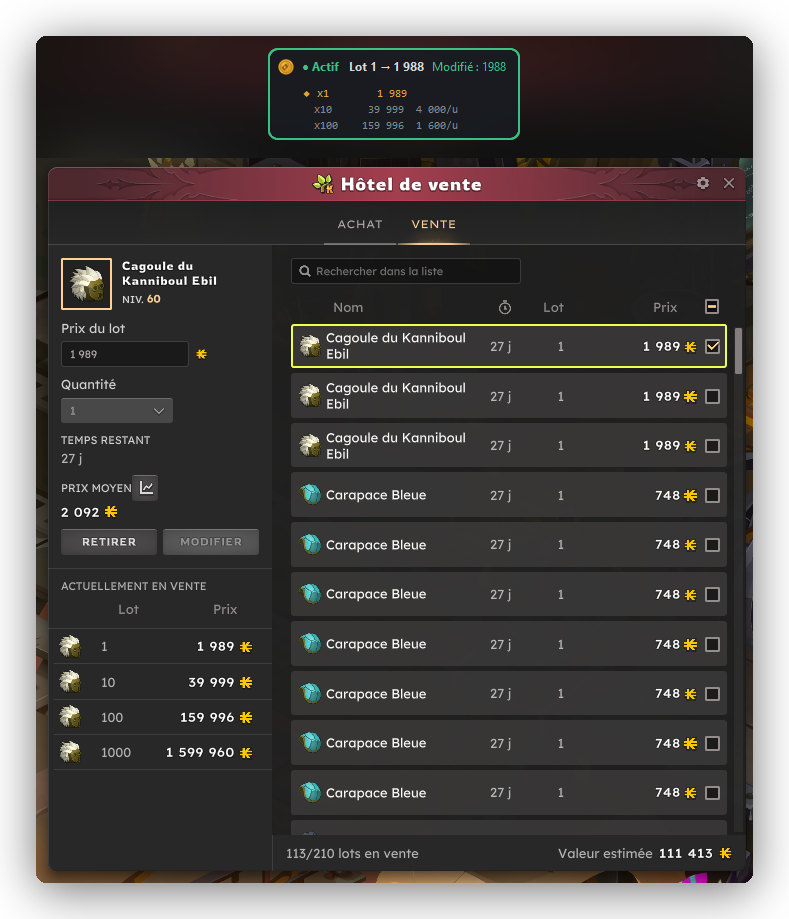

Le HUD change selon la situation et se règle dans **Options** : forme, taille, opacité, contenu et masquage automatique. Maintenez **Alt** pour le rendre cliquable : copier le dernier prix, arrêter un parcours ou ouvrir l'outil.

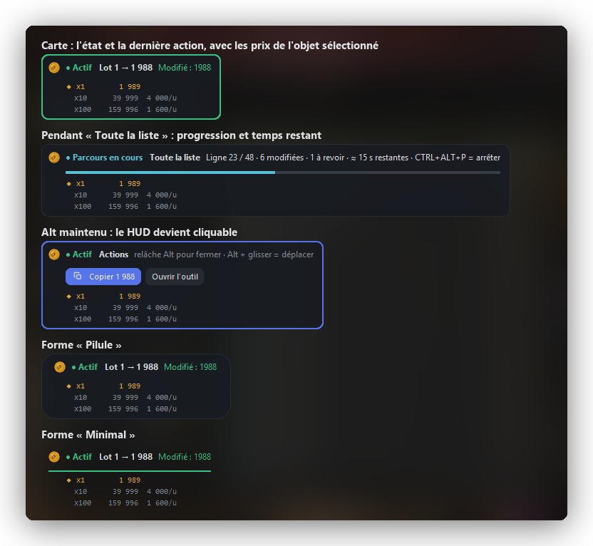

L'**aide-mémoire** (`Ctrl+Alt+H`) rappelle les touches par-dessus le jeu. Vous pouvez le déplacer : il reste alors affiché à cet endroit jusqu'au ✕.

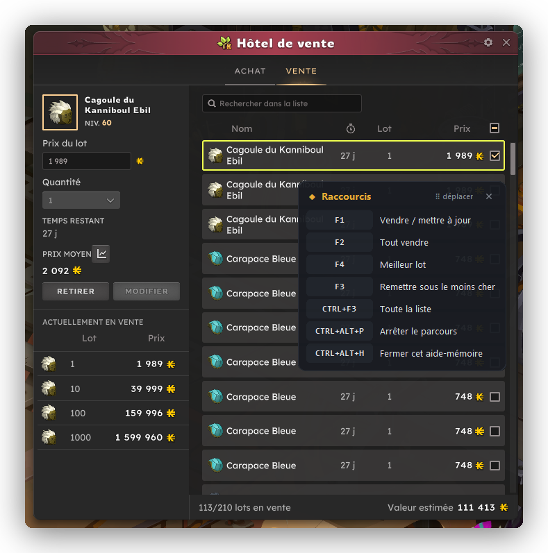

## La fenêtre principale

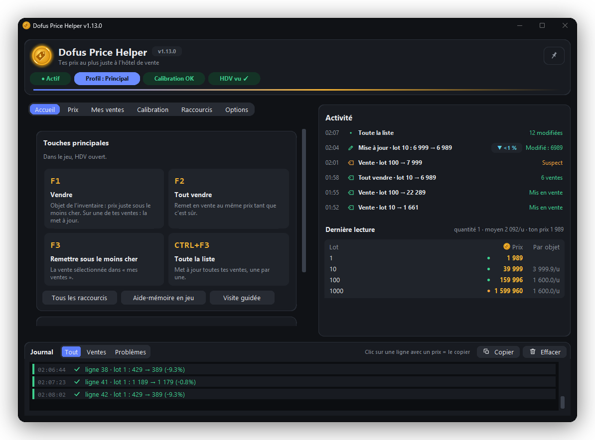

- **Barre d'état**, en haut : des pastilles indiquent si les raccourcis sont actifs, le profil, l'état de la calibration et si l'HDV a été vu. Un clic sur une pastille mène à l'endroit utile.
- **Accueil** : les touches principales, et les premiers pas tant qu'ils ne sont pas faits.
- **Activité**, à droite : les dernières actions, avec l'ancien et le nouveau prix. Une lecture douteuse apparaît en orange (« Suspect ») : l'outil n'a rien validé.
- **Dernière lecture** : les prix lus dans l'HDV pour chaque lot, et le prix par objet. La pastille devant chaque prix indique la fiabilité de la lecture : verte si elle est sûre, orange si elle est moyenne, rouge si elle est douteuse.
- **Journal**, en bas : tout ce que fait l'outil, filtrable (**Tout**, **Ventes**, **Problèmes**). Un clic sur une ligne qui contient un prix copie ce prix.

Plus de détails : [Interface](GUIDE.md#interface) dans le guide.

## Prix

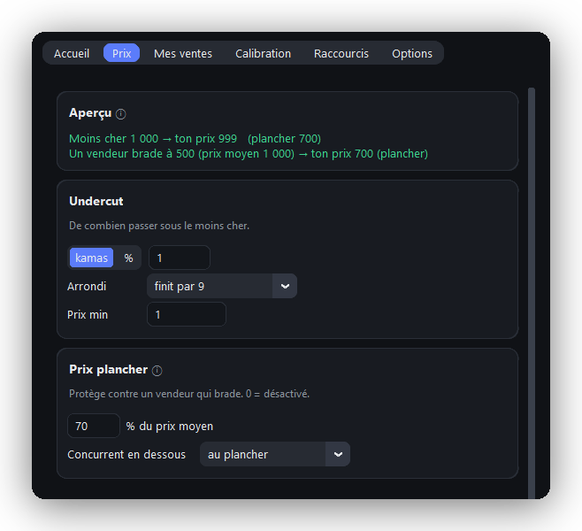

De combien passer sous le moins cher (en kamas ou en %), l'arrondi, le prix minimum et le **prix plancher**, calculé à partir du prix moyen de l'HDV pour ne pas suivre un vendeur qui brade. L'**aperçu**, en haut, montre le prix obtenu avec vos réglages, recalculé à chaque changement.

Plus de détails : [Sécurité des prix](GUIDE.md#sécurité-des-prix).

## Mes ventes

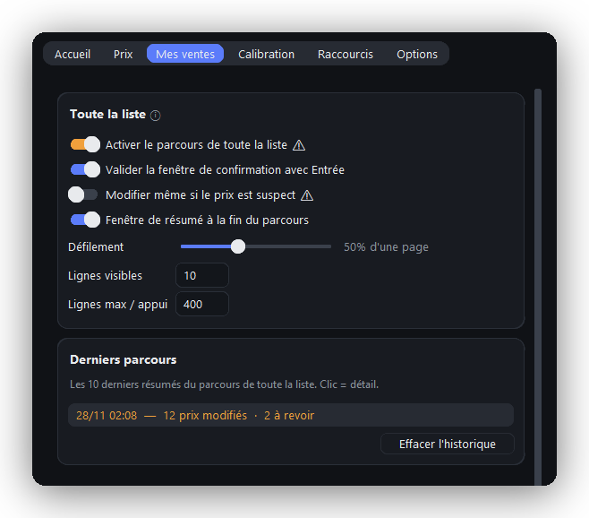

Les réglages de **Toute la liste** (`Ctrl+F3`), qui met à jour toutes vos ventes l'une après l'autre. Cette fonction est désactivée par défaut. Les 10 derniers parcours restent consultables ici.

À la fin de chaque parcours, un **résumé** s'ouvre : prix modifiés, lignes à revoir et pourquoi, lignes déjà au bon prix, durée. Chaque ligne montre le nom de l'objet tel qu'il apparaît dans le jeu. Un clic sur une ligne la retrouve dans le journal.

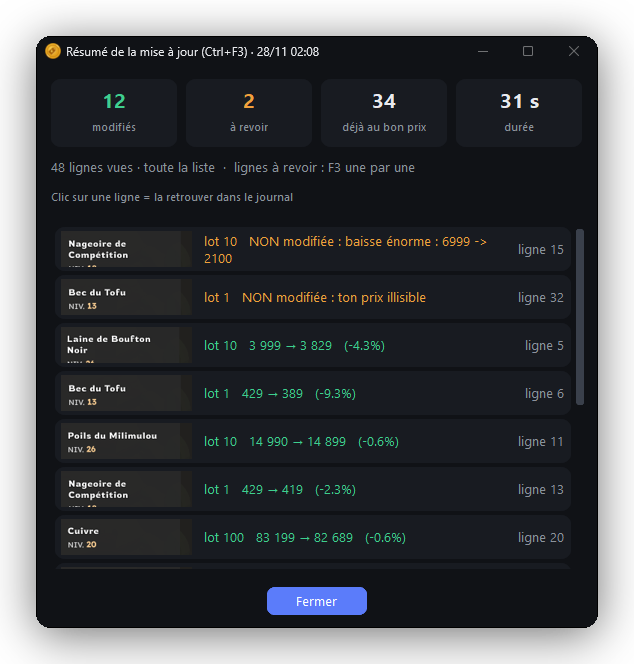

Plus de détails : [Vendre et mettre à jour les prix](GUIDE.md#vendre-et-mettre-à-jour-les-prix).

## Calibration

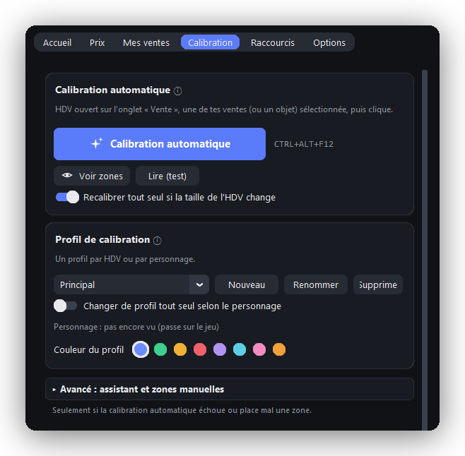

**Calibration automatique** : ouvrez l'HDV sur l'onglet **Vente**, sélectionnez un objet, puis cliquez. L'outil retrouve l'HDV à n'importe quelle résolution et place toutes les zones. Un profil de calibration par HDV ou par personnage, qui peut suivre le personnage joué.

Voici les zones que la calibration automatique place sur l'HDV (le bouton **Voir zones** les affiche en jeu) :

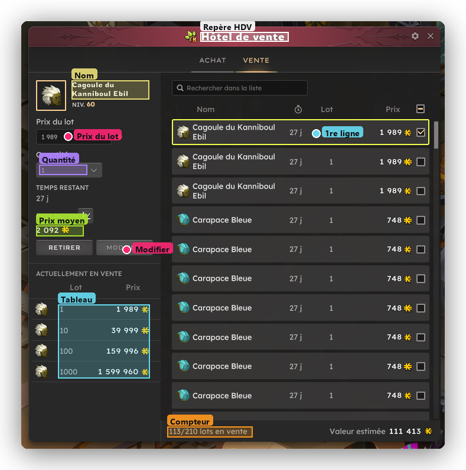

Plus de détails : [Calibration](GUIDE.md#calibration) et [Profils et multi-compte](GUIDE.md#profils-et-multi-compte).

## Raccourcis

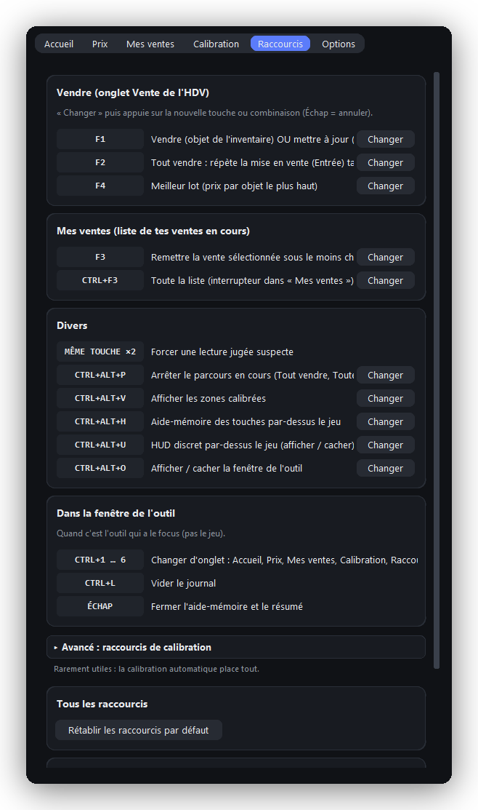

Toutes les touches se changent ici : **Changer**, puis la touche ou la combinaison voulue. Les raccourcis de calibration manuelle sont dans la section **Avancé**.

Plus de détails : [Raccourcis](GUIDE.md#raccourcis).

## Options

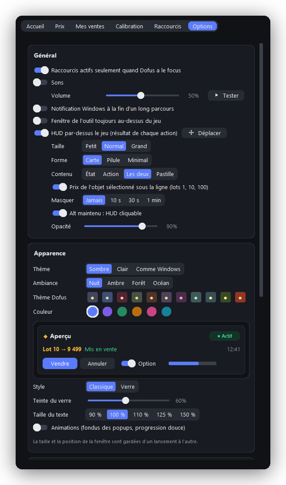

Le comportement général (raccourcis actifs seulement dans Dofus, sons, notifications, fenêtre toujours au-dessus), le HUD, la sécurité, la sauvegarde de vos réglages et les mises à jour.

## Apparence

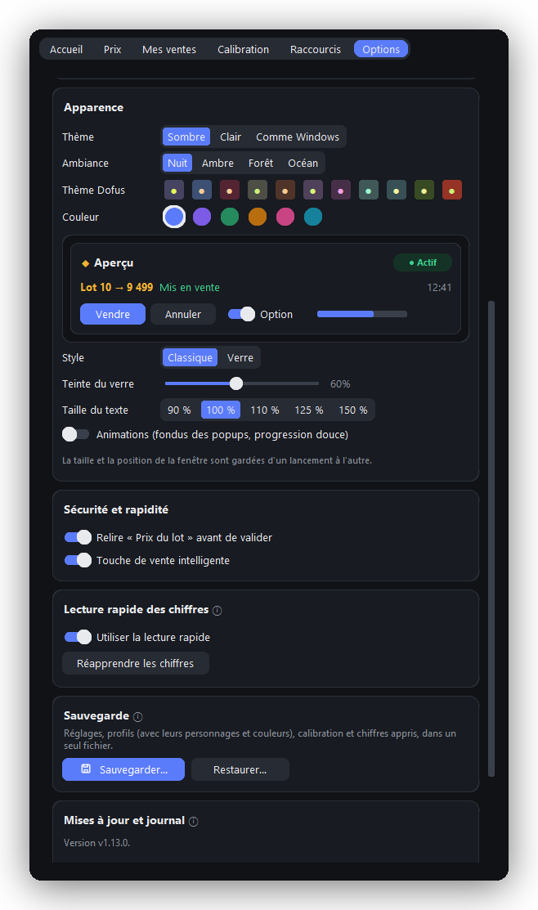

Thème sombre, clair ou comme Windows, couleur d'accent, taille du texte, style **Classique** ou **Verre** (le jeu flouté derrière l'outil). L'aperçu montre le résultat avant d'appliquer.

Le thème sombre propose quatre **ambiances** :

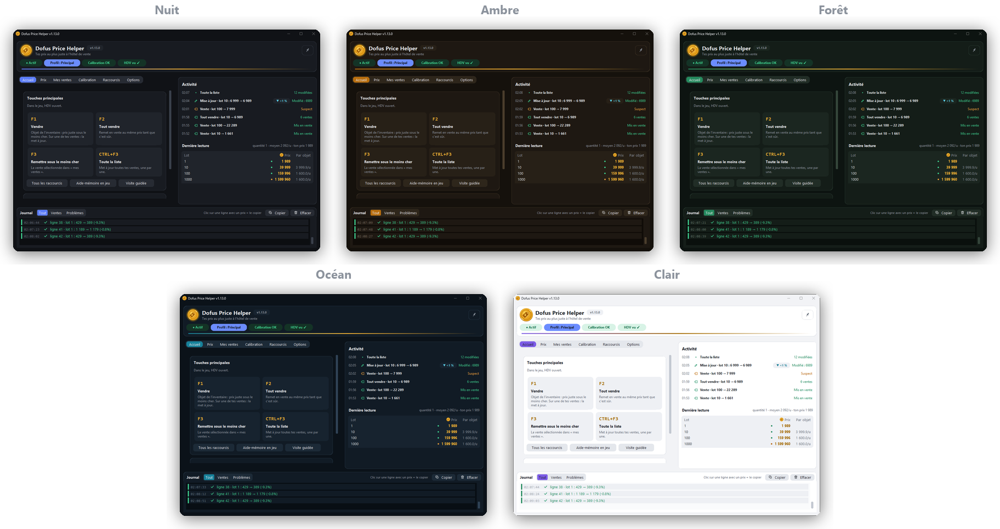

Et les 11 **thèmes de Dofus** (**Options › Thèmes** dans le jeu) : choisissez le même que dans le jeu pour que l'outil s'y fonde.

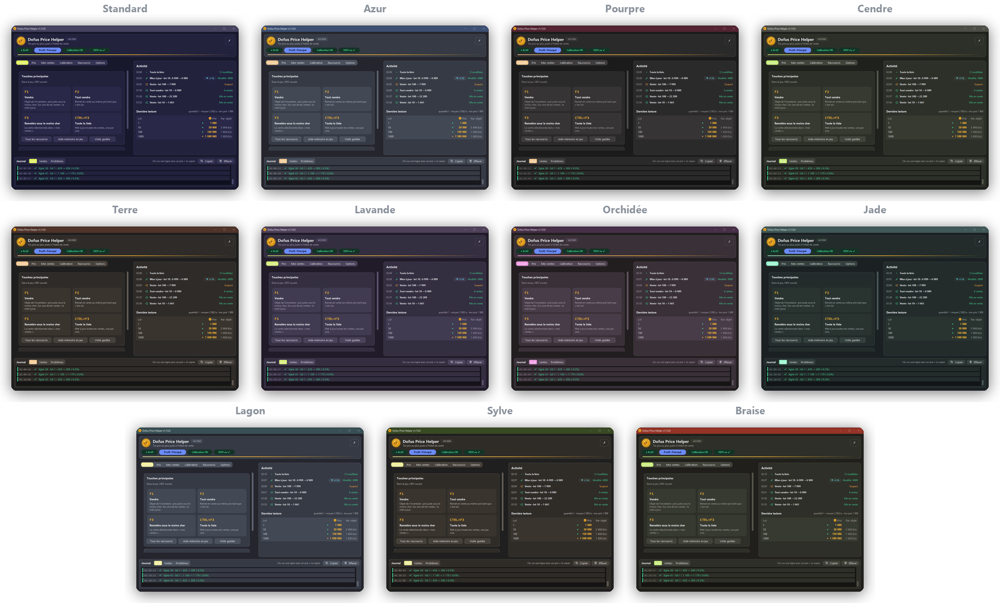

---

Les captures de cette page sont générées par [`tools/readme_shots.py`](../tools/readme_shots.py), avec des données d'exemple.
